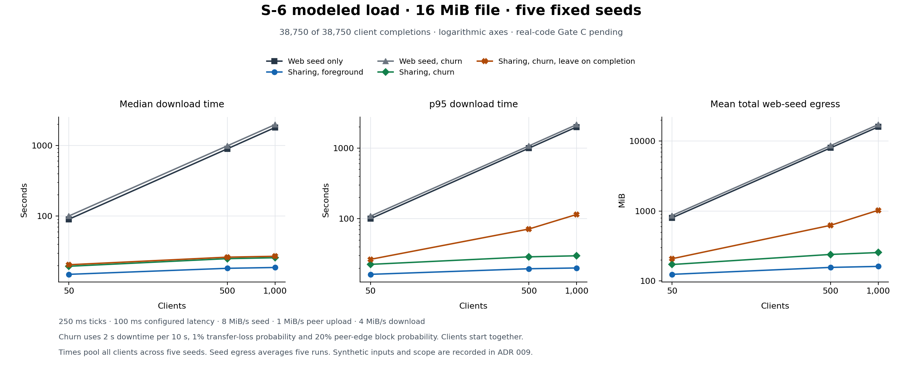

# S-6 seeded swarm load experiment

Measured on 2026-11-15, Mac arm64, Node 24.11.0. Source base 605c88b.
The containing commit identifies the experiment implementation. ADR 009 records
the isolated model and tool choices. Phase 1 review gates remain open.

## Method and assumptions

The metadata model tracks opaque chunk indices, virtual time and per-endpoint
service budgets. Every scenario starts all clients together with a 16 MiB file,
64 KiB chunks selected through core's existing size rule, 250 ms ticks and
100 ms configured latency. Delivery takes one service tick plus latency rounded
up to ticks, giving a 500 ms delay from dispatch for this configuration.

The single web seed has 8 MiB/s upload. Each client has 1 MiB/s upload and
4 MiB/s download shared among its transfers. At most eight peer edges plus one
web-seed path are available per client. Shuffled undirected cycles form a fixed
bounded graph. Each request uses local piece availability and a seeded source
choice. The final missing piece can use a peer and the web seed concurrently,
within the existing service budgets. Every attempted transfer charges its full
piece size. Unique, duplicate, dropped and still-in-flight bytes are separate.

Five fixed seeds, 0x53360001 through 0x53360005, run at 50, 500 and 1000 clients.
The five scenarios give 75 runs and 38750 client outcomes. Foreground scenarios
keep completed clients active until the experiment ends. Churn adds independently
seeded periodic downtime of 2 seconds per 10 seconds, 1% whole-transfer loss
probability and 20% permanent block probability per peer edge. The departure scenario additionally makes
completed clients leave immediately. These inputs describe synthetic conditions.

Each run has a 4000000 ms horizon. Missing completion times sort after every
observed completion. Median averages the middle pair and p95 uses nearest rank,
pooling client outcomes across five seeds. A percentile that reaches an
incomplete client remains null. All observed clients completed in these runs.

## Measured model results

Seed MiB is the mean total web-seed egress per run. Seed MiB/s divides each run's
egress by that run's virtual completion time, then averages the five rates.
These are virtual capacities and traffic counters. Host network throughput
requires the real-stack experiment.

| Scenario | Clients | Median seconds | p95 seconds | Seed MiB | Seed MiB/s |
|---|---|---|---|---|---|
| web-seed-only | 50 | 90.250 | 99.750 | 800.000 | 7.960 |
| web-seed-only | 500 | 893.500 | 994.250 | 8000.000 | 7.996 |
| web-seed-only | 1000 | 1787.625 | 1987.000 | 16000.000 | 7.998 |
| swarm-foreground | 50 | 15.000 | 16.250 | 124.075 | 7.521 |
| swarm-foreground | 500 | 18.250 | 19.500 | 155.900 | 7.663 |
| swarm-foreground | 1000 | 18.750 | 20.000 | 161.113 | 7.709 |
| web-seed-churn | 50 | 100.375 | 108.250 | 861.400 | 7.907 |
| web-seed-churn | 500 | 985.500 | 1071.250 | 8614.600 | 7.992 |
| web-seed-churn | 1000 | 1965.000 | 2144.250 | 17243.112 | 7.995 |
| swarm-churn | 50 | 19.500 | 22.500 | 171.537 | 7.319 |
| swarm-churn | 500 | 25.000 | 28.750 | 238.975 | 7.458 |
| swarm-churn | 1000 | 25.750 | 29.750 | 254.275 | 7.492 |
| swarm-churn-leave | 50 | 20.500 | 26.500 | 207.500 | 7.678 |
| swarm-churn-leave | 500 | 26.250 | 71.250 | 623.725 | 7.822 |
| swarm-churn-leave | 1000 | 27.000 | 114.500 | 1023.750 | 7.921 |

From 50 to 1000 clients, the web-seed-only p95 grows from 99.75 to 1987 seconds.
Foreground sharing grows from 16.25 to 20 seconds. With the specified churn,
sharing grows from 22.5 to 29.75 seconds. Immediate departure raises that churn
p95 from 26.5 to 114.5 seconds. At 1000 clients, departure also raises mean
web-seed egress from 254.275 to 1023.750 MiB. Tail behavior depends on how long
completed downloaders remain active.

The maximum observed in-flight count is 8064, below the 65536 experiment cap.
Every recorded service peak is within its endpoint budget. The 75 model calls
took 10.581 seconds of host execution time in the recorded run. Sampled process
RSS grew from 55721984 to 298893312 bytes, with the same 298893312-byte maximum
across the recorded boundary samples. The raw report samples before the
experiment, after each run and at the end.
Sampling at those boundaries leaves transient peaks unmeasured. Metadata caps
bound the modeled state. They do not establish a browser's payload-memory cost.

## Acceptance and regression evidence

The acceptance suite first failed because the module was absent. The first
implementation then failed S6-CHURN with 11 of 12 clients complete at 60000 ms.
Always preferring a peer left four pieces stranded behind a periodically failing
path. Extending that failed model to 300000 ms still left the same client
incomplete. The same acceptance seed now completes with seeded source choice
and the bounded T7 final-piece request. The completed model passes eight tests.

- S6-REPLAY checks exact deterministic results and reciprocal, unique,
  self-free neighborhoods bounded by eight peers.
- S6-ACCOUNT checks completion, byte conservation and service budgets.
- S6-TIME checks the 500 ms single-piece service/latency result.
- S6-CHURN checks preserved pieces and lost-transfer accounting under churn,
  whole-transfer loss and blocked paths.
- S6-CHAOS removes every virtual peer path at 750 ms during transfer. The
  clients finish through the surviving web seed. A web-seed-only control also passes.
- S6-EMPTY reports zero completion when the web seed has zero upload capacity.
- S6-BOUNDS rejects invalid clocks, probabilities, rates and allocations.
- S6-REPORT checks the compiled model SHA-256, all 75 runs, all client outcomes,
  resource counters and summary arithmetic against the committed evidence.

## Reproduce and tooling

Run `pnpm build`, then `node tools/run-swarm-spike.mjs`. Numerical outcomes replay
for the saved seeds and model. Host timing, sampled RSS, measurement date and
source-base identifier vary by execution. Run `pnpm check` and
`pnpm test:browser` for the repository checks. The simulator adds zero external
npm dependencies. The lockfile adds an empty local-workspace importer.

Render the chart using `python tools/plot-swarm-spike.py` with Matplotlib 3.10.8
in an external Python environment. This run used Python 3.11.15 and eleven
installed distributions totaling 70012741 file bytes. Matplotlib's arm64 wheel
is 8139625 bytes. Exact tool versions, license metadata and the zero-finding OSV
exact-version advisory query are recorded in S-6-plot-environment.json.
No independent audit of the plotting environment has been established.
The temporary environment was removed after rendering and visual inspection.

## Task report

Task S-6 seeded load experiment. Phase 1 branch, early-spike scope. The
containing commit supplies the task commit identifier.

Tests run include the eight S6 tests above. The full local suite passed one
foundation test, 61 Vitest tests and ten browser tests, plus 79 independent
protocol vectors. Strict types, builds, lint, 138 installed-package license
checks, dependency advisory audit and whitespace checks passed. CI is reported
with the implementation commit.

Measured results include 75 runs, 38750 completions, the median/p95 and seed
traffic table, and the 8064-transfer observed maximum. The chart was rendered
and visually inspected on this Mac. Claims-ledger rows use S6-REPLAY/ACCOUNT/
BOUNDS, S6-MODEL, S6-TAIL, S6-CHAOS/EMPTY, S6-REPORT and SC-8/GATE-C.

Not verified on a real device includes swarm transfers on Xiaomi, older Android,
iPhone, Safari or Windows, actual network bandwidth, battery, congestion, browser
memory and transport limits. Real payload hashing, reviewed encryption,
authenticated manifests, framing, discovery, Carrier integration and the
application's multi-carrier chaos test remain incomplete. Gate C requires the
model result to hold with real code. The Phase 1 external crypto review and wire
freeze are still outstanding. The pending Xiaomi codec comparison and deferred
offline-hotspot experiment keep their existing status.

Files changed comprise packages/sim's source, test, README, package manifest and
TypeScript configuration, the root build script and workspace lockfile,
tools/run-swarm-spike.mjs, tools/plot-swarm-spike.py, tools/swarm-report.test.ts,
ADR 009, this report, the raw load JSON, chart PNG, plotting-environment JSON,
docs/claims-ledger.md and docs/test-matrix.md.
